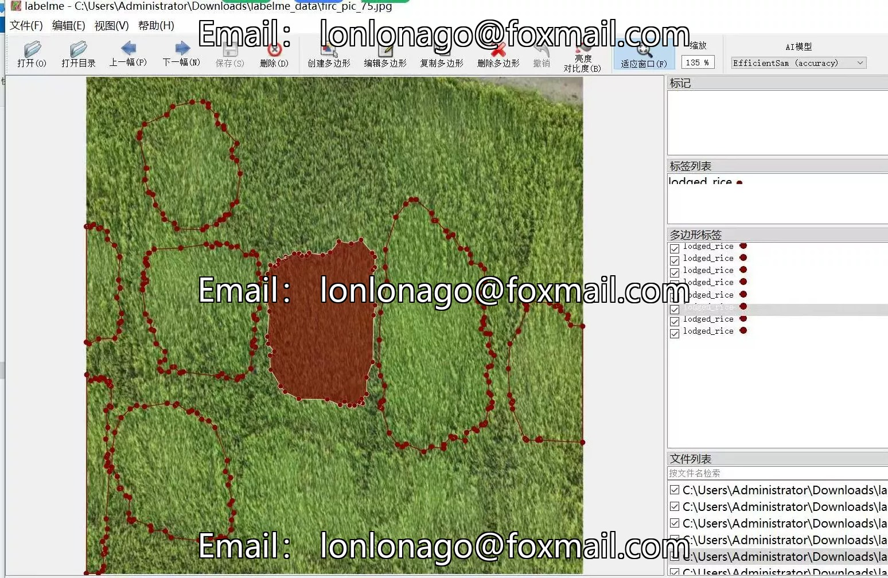
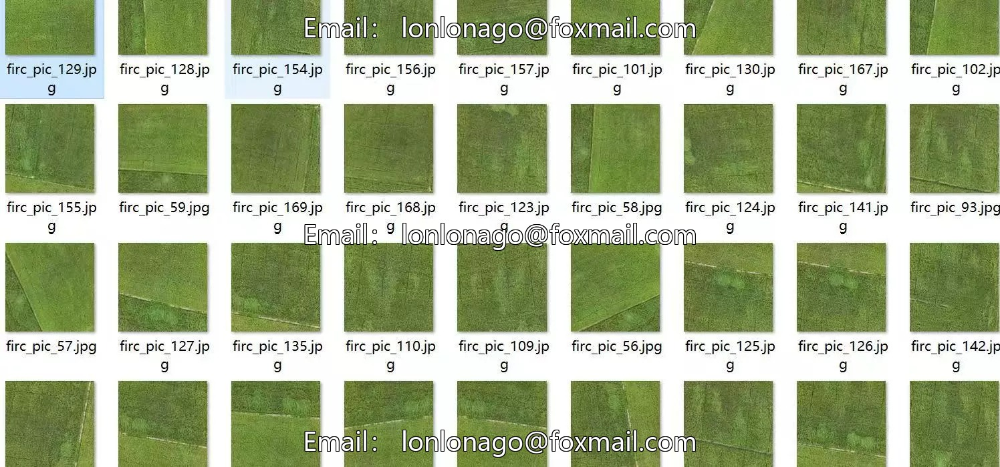
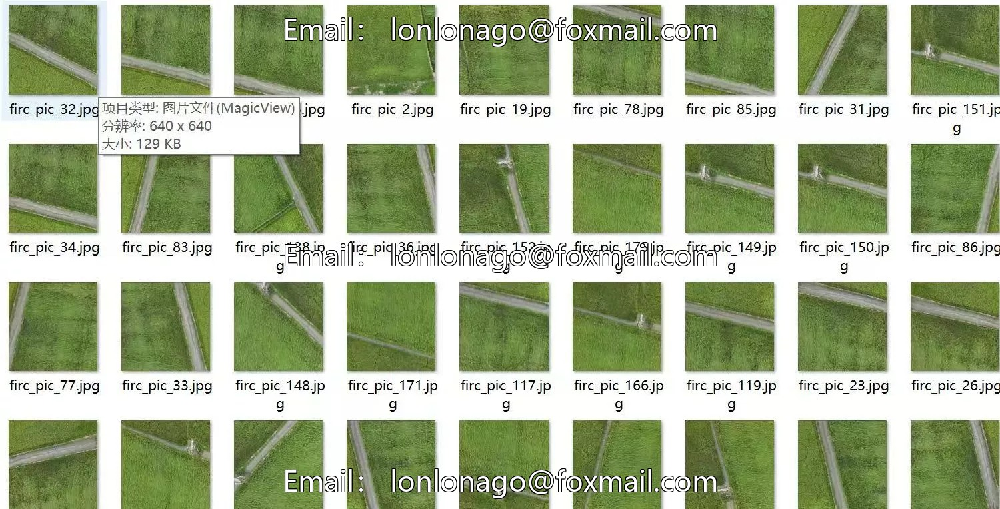
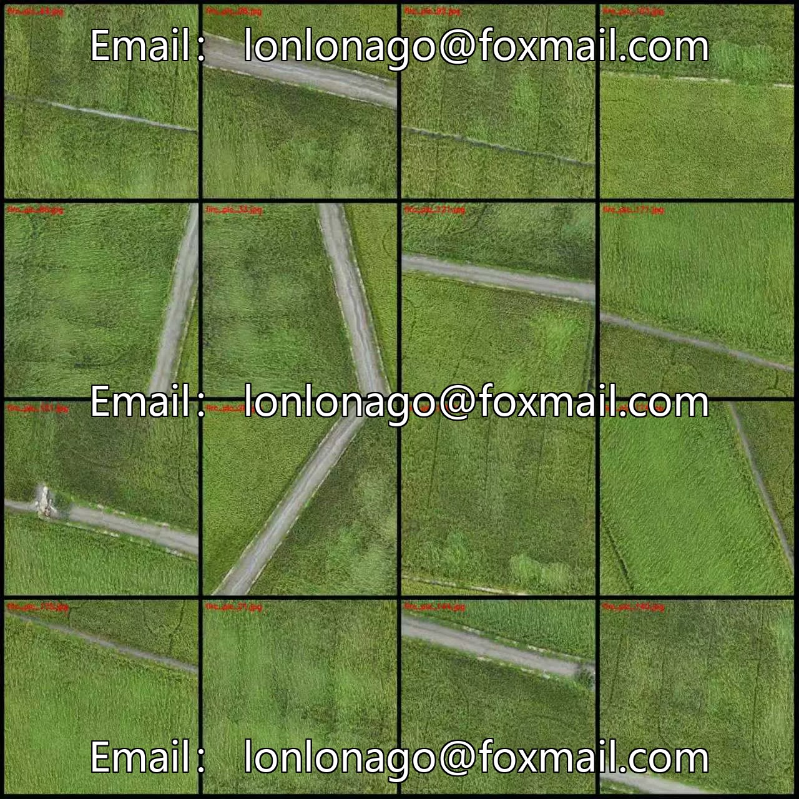
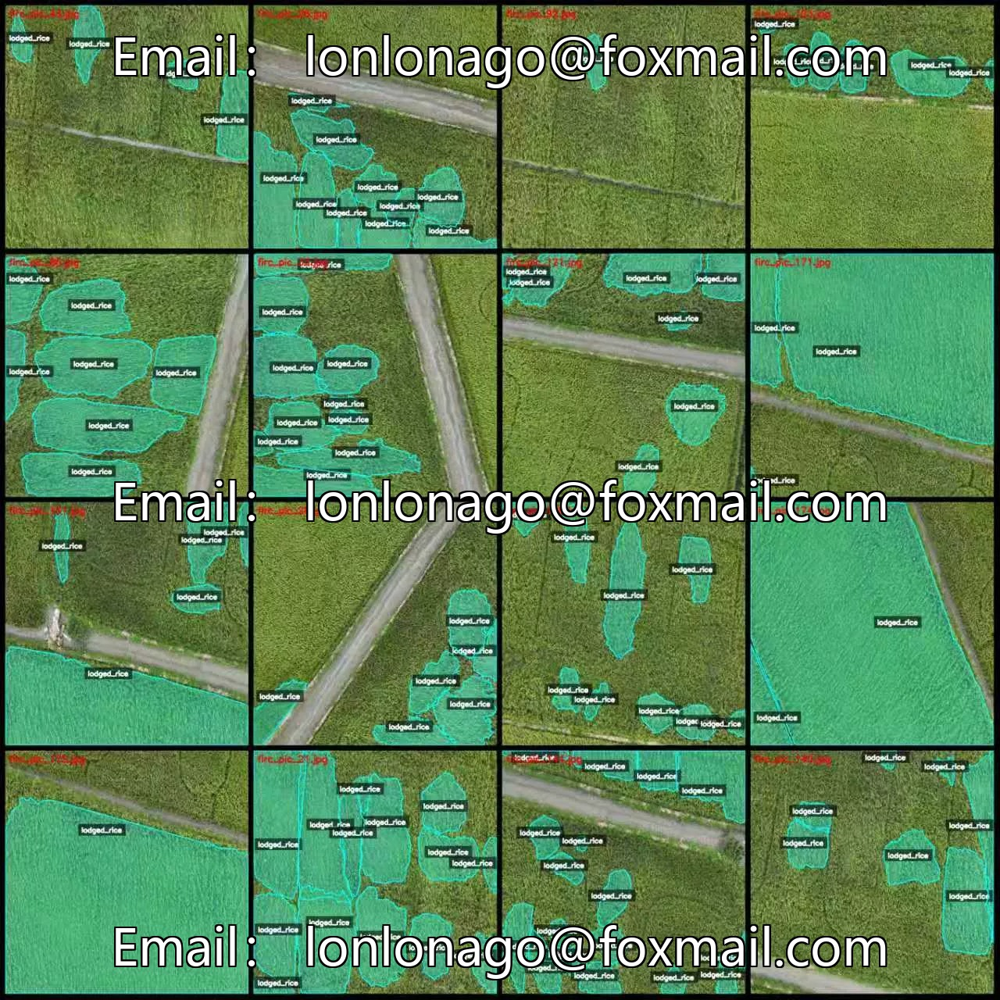

# Drone-viewed Rice Bending Recognition and Segmentation Dataset in LabelMe format: 175 images.

## Body

Drone-viewed Rice Bending Recognition and Segmentation Dataset - LabelMe format - 175 images in 1 category
Warm Reminder: Due to the dataset's replicability, please confirm compliance with requirements before purchasing.
Dataset format: LabelMe format (excluding mask files, only including jpg images and corresponding json files)
Number of images (number of jpg files): 175
Number of annotations (number of json files): 175
Number of annotation categories: 1
Annotation category names: ["lodged_rice"]
Number of bounding boxes per category
lodged_rice count = 1267
Total number of bounding boxes: 1267
Annotation tool used: labelme=5.5.0

Image resolution: 640x640
Annotation rules: Polygons are drawn around the categories.
Important Note: The dataset can be opened and edited using labelme, and the JSON dataset needs to be converted into either mask or YOLOF format for semantic segmentation or instance segmentation.
Special : This dataset does not guarantee any accuracy in the trained models or weight files.

## Images

## Payment

Here is a pay link on Stripe ( https://buy.stripe.com/3cs8yP7sY87d0vu9AB ). Please contact me lonlonago@foxmail.com after funding $89, and I will send you a complete data files , thank you!

